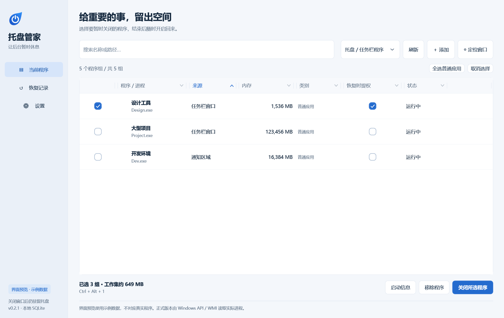
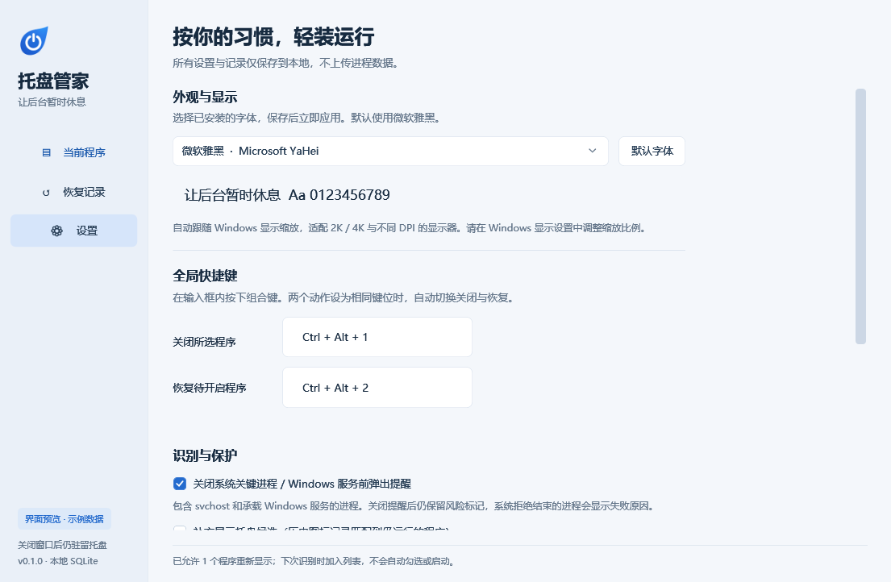

# 托盘管家 - TrayLeaf

<p align="center">Windows 10/11 托盘工具</p>
<p align="center">游戏前关闭选定后台 结束后按需重新启动</p>


## 功能

- 可一键关闭勾选的程序 也可一键恢复关闭的程序
- 默认识别托盘 / 任务栏可见程序  也可切换全部进程
- 勾选后批量关闭；记录程序名称、路径、启动参数，按需重新启动
- 每个程序可单独选择恢复时是否已管理员模式启动
- 支持手动添加程序、鼠标定位目标窗口和识别进程
- 支持移除不想显示的程序，并可在设置中恢复显示
- 快捷键支持，可自定义或设为同一组合键
- 系统/服务进程风险识别
- 使用本地SQLite 保存设置与恢复记录

## 下载与使用

在本仓库的 [Releases](https://github.com/yunnikuu/TrayLeaf/releases) 页面下载 压缩包/安装程序 ，解压/安装后运行 `TrayLeaf.exe`

### 运行条件
- Windows 10/11 64位操作系统。
- .NET Framework **4.8 或更高版本**

详细使用与行为边界：[使用说明](docs/USAGE.md)。

## 构建

在仓库根目录打开 **Windows PowerShell**：

```powershell
powershell.exe -NoProfile -ExecutionPolicy Bypass -File .\build.ps1
```



## 注意事项

正式 EXE 未进行代码签名；若出现系统安全提示，请审阅源码并自行判断，不要关闭系统防护
**关闭进程可能丢失未保存数据；恢复仅重新启动程序，不恢复文档、登录会话、窗口位置或内存状态**
**误关系统进程可能导致注销、黑屏或系统崩溃。不建议关闭系统/服务进程**