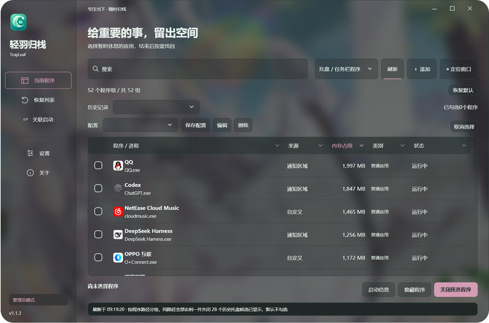

# 轻羽归栈 - TrayLeaf

<p align="center">Windows 10/11 后台管理工具</p>
<p align="center">游戏前关闭选定后台，结束后按需恢复启动</p>



> 轻羽归栈用来管理在游戏/特地场景时暂时用不到 但工作结束后需要继续使用的后台应用
 
> 可以选好程序，一次关闭；等游戏或工作结束，再从记录中选择需要重新打开的应用

- 软件常驻托盘，支持配置和全局快捷键，适合经常需要切换后台应用的使用场景

## 功能

- **批量关闭与恢复**：识别托盘、任务栏程序，也可查看全部运行进程；记录名称、路径和启动参数
- **历史记录与配置**：保留最近的操作记录，也能保存常用组合，不必每次重新选择
- **关联启动**：为程序指定另一个恢复目标，实现“关闭 A，恢复时启动 B”
- **程序管理**：支持手动添加、窗口定位、隐藏程序和自定义显示名称
- **托盘与快捷键**：支持自定义全局快捷键、开机自启动等功能
- **外观与语言**：支持简体中文、繁体中文、英语，提供深浅模式、主题色、字体缩放和自定义背景
- **风险提醒与本地保存**：识别系统 / 服务进程风险，禁止关闭已识别的杀毒类软件；设置与历史记录等保存在本机 SQLite 数据库中
- **软件内更新**：支持检查新版本与直接下载安装包

## 下载与使用

在 [Releases](https://github.com/yunnikuu/TrayLeaf/releases) 下载 ZIP 便携版或 MSI 安装版。便携版解压后运行 `TrayLeaf.exe`

详情使用和各项设置见 [使用说明](docs/使用说明.md)。

### 运行条件

- Windows 10/11 64 位操作系统
- .NET Framework **4.8 或更高的 4.x 就地版本**

## 构建

项目使用 C#、WPF 和 SQLite。在仓库根目录打开 **Windows PowerShell**：

```powershell
powershell.exe -NoProfile -ExecutionPolicy Bypass -File .\build.ps1
```

## 注意事项

- **关闭前请保存工作。恢复只会重新启动程序，不会还原文档、登录会话、窗口位置或内存状态。**
- 误关系统 / 服务进程可能导致服务中断、注销、黑屏或系统崩溃，不建议关闭这类进程。
